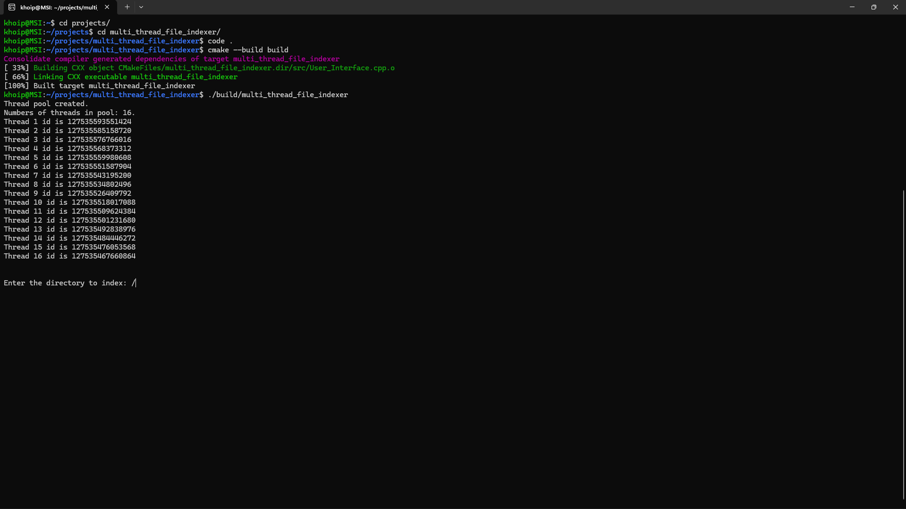
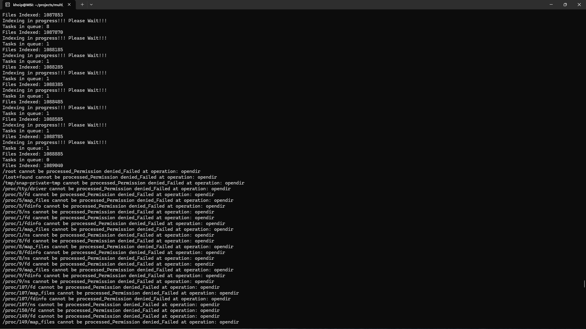
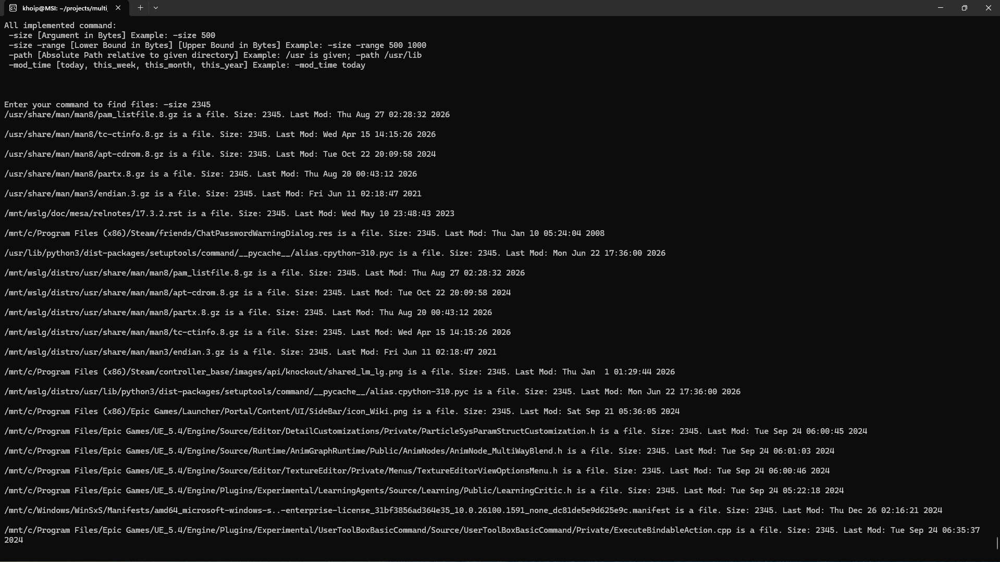
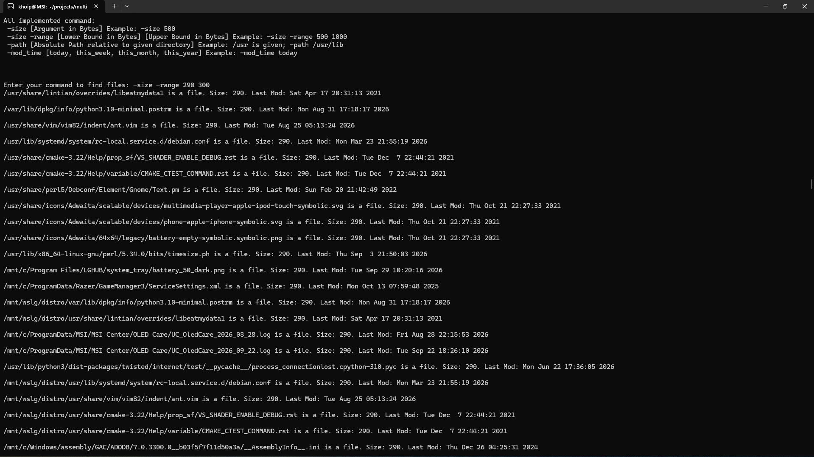

## Project Description:

This is a multithread file indexer program. Given a a path it will scan and index all files and directories including the given path. This is a demonstration of using POSIX to traverse Linux filesystem, C++20 features, templates, constrains/concepts, type erasure, thread, data structure, RAII and architecting a coherent project.

## What problem it solves:

After the program finished scanning the files and directories in a given path, it then can be quick search to get all the files or directories inside that path using path, modified timed and size of the files and directories.

## Requirements:

Linux

Cmake 3.20 or newer

A C++20 compiler (GCC 11+ or Clang 14+)


## Build instructions:

```bash
git clone https://github.com/PorosEnyoyers/multi_thread_file_indexer
cd multi_thread_file_indexer
cmake -S . -B build -DCMAKE_BUILD_TYPE=Release
cmake --build build -j
```
The binary is at `build/multi_thread_file_indexer`

## Run instructions:

```bash
./build/multi_thread_file_indexer
```

Enter an absolute path for the indexer to index all the files and directories underneath that path.

All implemented command: 

-size [Argument in Bytes] Example: -size 500

-size -range [Lower Bound in Bytes] [Upper Bound in Bytes] Example: -size -range 500 100

-path [Absolute Path relative to given directory] Example: /usr is given; -path /usr/lib

-mod_time [today, this_week, this_month, this_year] Example: -mod_time today

Starting program. Entering path pop up:


Finished indexing with info and log printed:


Search for size:


Search for range size:


## Sanitizers

The project is under 3 sanitizers:

# Asan + UBsan 
In CMakeList.txt:

Add `#` before every line in: (If there's `#` before these lines ignore this)
```
set(SANITIZE "address,undefined" CACHE STRING "Value for -fsanitize=")
foreach(tgt multi_thread_file_indexer indexer_tests)
    target_compile_options(${tgt} PRIVATE -fsanitize=${SANITIZE} -g -fno-omit-frame-pointer)
    target_link_options(${tgt} PRIVATE -fsanitize=${SANITIZE})
endforeach()
```
Remove `#` before every line in: (If there's no `#` before these lines ignore this)
```
#target_compile_options(multi_thread_file_indexer PRIVATE -fsanitize=address,undefined -g -fno-omit-frame-pointer)
#target_link_options(multi_thread_file_indexer PRIVATE -fsanitize=address,undefined)

#target_compile_options(indexer_tests PRIVATE -fsanitize=address,undefined -g -fno-omit-frame-pointer)
#target_link_options(indexer_tests PRIVATE -fsanitize=address,undefined)
```

Run this in console:
```
cmake -S . -B build && cmake --build build
```

# Result:
Indexed 1.1 million files starting from `/` with no report errors or leaks.

Correctness check every `/usr` files was index at 71600 files exactly matches `find /usr | wc -l` command in Linux

# Tsan
Warning:
On WSL2, TSan may fail at startup with "unexpected memory mapping". Run
`sudo sysctl vm.mmap_rnd_bits=28` and retry.

In CMakeList.txt:

Add `#` before everyline in: (If there are `#` before these lines ignore this)
```
target_compile_options(multi_thread_file_indexer PRIVATE -fsanitize=address,undefined -g -fno-omit-frame-pointer)
target_link_options(multi_thread_file_indexer PRIVATE -fsanitize=address,undefined)

target_compile_options(indexer_tests PRIVATE -fsanitize=address,undefined -g -fno-omit-frame-pointer)
target_link_options(indexer_tests PRIVATE -fsanitize=address,undefined)
```

Remove `#` before everyline in: (If there's no `#` before these lines ignore this)
```
#set(SANITIZE "address,undefined" CACHE STRING "Value for -fsanitize=")
#foreach(tgt multi_thread_file_indexer indexer_tests)
    #target_compile_options(${tgt} PRIVATE -fsanitize=${SANITIZE} -g -fno-omit-frame-pointer)
    #target_link_options(${tgt} PRIVATE -fsanitize=${SANITIZE})
#endforeach()
```

Run this in console:
```
cmake -S . -B build-tsan -DSANITIZE=thread
cmake --build build-tsan
```

Warning:
On WSL2, TSan may fail at startup with "unexpected memory mapping". Run
`sudo sysctl vm.mmap_rnd_bits=28` and retry.

# Result:
Indexed 1.1 million files starting from `/` with no report of data race or deadlock from threads.

Correctness check every `/usr` files was index at 71600 files exactly matches `find /usr | wc -l` command in Linux